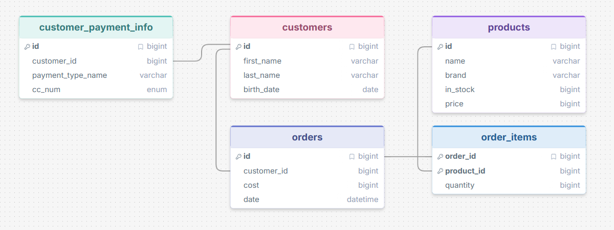

# Online Store — AI + SQL Natural Language Interface

My project models the database of a small online electronics store: customers, their saved payment methods, products and inventory, orders, and the items in each order. You can ask it questions in plain English, like "who hasn't ordered anything yet?", and it answers from the data.



## How it works

1. The question and the schema ([schema.sql](schema.sql)) go to `gpt-4o-mini`, which returns a SQLite query.
2. The query runs against [store.db](store.db) on a **read-only** connection, so generated SQL can't change the data.
3. The question, the SQL and the rows go back to GPT, which writes a friendly answer.

## Setup

```bash
pip install -r requirements.txt
```

Copy `secrets.example.json` to `secrets.json` and add your OpenAI API key. `secrets.json` is git-ignored.

```bash
python setup_db.py
```

```bash
python app.py --strategy zero_shot
```

```bash
python run_experiments.py
```

`setup_db.py` rebuilds `store.db` from a fixed random seed. `app.py` is the interactive CLI. `run_experiments.py` runs 10 questions under all three strategies and writes [results.md](results.md).

## Prompting strategies

From [Chang & Fosler-Lussier, *How to Prompt LLMs for Text-to-SQL*](https://arxiv.org/abs/2305.11853):

| Strategy | What the prompt contains |
|---|---|
| `zero_shot` | Schema + question |
| `single_domain` | Schema + 3 example question/SQL pairs written for this store database + question |
| `cross_domain` | A different (library) schema with 3 example question/SQL pairs, then the store schema + question |

## Query it did well on

**Question:** Which customers bought a product that is now out of stock, so we can tell them it's backordered?

**GPT SQL Response (zero-shot):**

```sql
SELECT DISTINCT c.id, c.first_name, c.last_name
FROM customers c
JOIN orders o ON c.id = o.customer_id
JOIN order_items oi ON o.id = oi.order_id
JOIN products p ON oi.product_id = p.id
WHERE p.in_stock = 0;
```

**Friendly Response:** The following customers bought a product that is now out of stock and can be informed that it's backordered: Mason Taylor, Olivia Brown, Isabella Thomas, Benjamin Clark, Ethan Wilson, Charlotte Harris, James White, Ava Martinez.

This is a four-table join, and the model correctly read "out of stock" as `in_stock = 0`. All three strategies produced the same correct query.

## Question it tripped up on

**Question:** Which brand has brought in the most revenue?

**GPT SQL Response (same under all three strategies):**

```sql
SELECT p.brand, SUM(o.cost) AS total_revenue
FROM products p
JOIN order_items oi ON p.id = oi.product_id
JOIN orders o ON oi.order_id = o.id
GROUP BY p.brand
ORDER BY total_revenue DESC
LIMIT 1;
```

**Friendly Response:** The brand that has brought in the most revenue is Logitech, with a total revenue of $7,508.07.

**This is wrong.** `orders.cost` is the total for the *whole* order, so an order with several items gets its full cost counted once for every item. Logitech's real revenue is $2,069.72. The correct query sums `p.price * oi.quantity`, which shows **Garmin** on top at $3,249.87. The answer sounds confident and plausible, and nothing in the output hints that it's wrong. None of the strategies avoided the mistake, because none of the examples showed revenue computed from line items.

### The answer step can fail too

**Question (single-domain):** Which customers under 30 have spent more than $500 in total?

The SQL was correct and returned Olivia Brown, Ava Martinez and Mason Taylor with their totals. The friendly response then said:

> It looks like there are no customers under 30 who have spent more than $500 in total. The customers listed ... are not under 30 years old based on the data we have.

The query had already filtered by age, but the age column wasn't in the result. The model second-guessed the data it was handed and contradicted it. The zero-shot and cross-domain runs got the same rows and answered correctly.

## Strategy comparison

All 10 questions were run under each strategy with `temperature=0`:

| Question | zero_shot | single_domain | cross_domain |
|---|---|---|---|
| Customers with no orders | ✅ | ✅ | ✅ (used `LEFT JOIN` like the library example) |
| Best-selling product | ⚠️ tie hidden by `LIMIT 1` | ⚠️ same | ⚠️ same |
| 2025 revenue | ✅ | ✅ (did cents→dollars in SQL) | ✅ |
| Top brand by revenue | ❌ double counting | ❌ | ❌ |
| Oldest customer's purchases | ✅ | ⚠️ dropped quantity, so it said 3 controllers instead of 4 | ✅ |
| American Express holders | ✅ | ✅ | ✅ |
| Busiest month | ✅ | ✅ | ✅ |
| Customers to notify of backorder | ✅ | ✅ | ✅ |
| Under 30, spent > $500 | ✅ | ❌ answer contradicted correct SQL | ✅ |
| Order totals that don't match items | ✅ | ✅ | ✅ |

**What I noticed:**

- On this small, clearly named schema, `gpt-4o-mini` writes correct SQL almost every time. The strategies changed the *style* of the queries more than whether they were right.
- **Single-domain** examples were copied closely. Because one example did `SUM(cost) / 100.0 AS total_spent_dollars`, the model started converting cents to dollars inside SQL. It also copied the `DISTINCT p.name` pattern and dropped quantities it should have kept. Examples help with conventions, but the model imitates them even where they don't fit.
- **Cross-domain** examples carried over structure (`LEFT JOIN ... IS NULL`, a library-style join chain) without any store-specific habits. In this run it scored the same as zero-shot.
- The most serious error (brand revenue) was a reasoning mistake about what a column *means*. No prompting strategy fixed it. A single-domain example that computes revenue from `order_items` would probably fix it, but that only works if you already know which questions the model will get wrong.
- Mistakes happen in both steps. Even with perfect SQL, the answer step can misread the result, so a friendly answer by itself can't be trusted. Showing the SQL and the rows next to it is what makes errors catchable.

## Cost

All 30 runs (60 API calls, roughly 40k input tokens) come to an estimated $0.01 or less at `gpt-4o-mini` prices. Check the OpenAI usage dashboard for the exact figure.

## More examples

See [results.md](results.md) for all 10 questions under each strategy (30 runs).

## Notes on the schema

- SQLite has no `bigint` or `enum`, so IDs are `INTEGER PRIMARY KEY` and `cc_num` is `TEXT`. The card numbers are randomly generated fakes.
- Money (`products.price`, `orders.cost`) is stored as integer cents. The schema comments say so, which tests whether the model remembers to divide by 100.
- `order_items` has a composite primary key `(order_id, product_id)`, and every foreign key is declared.
